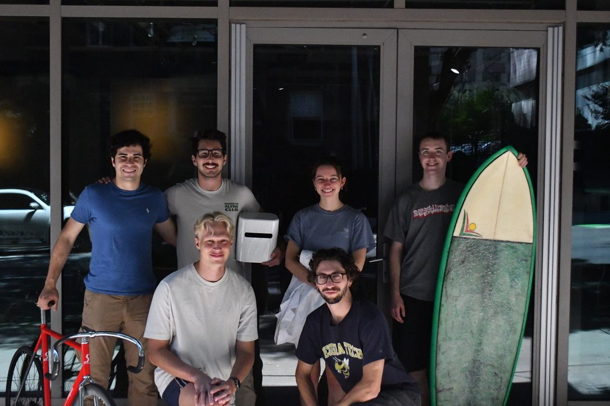
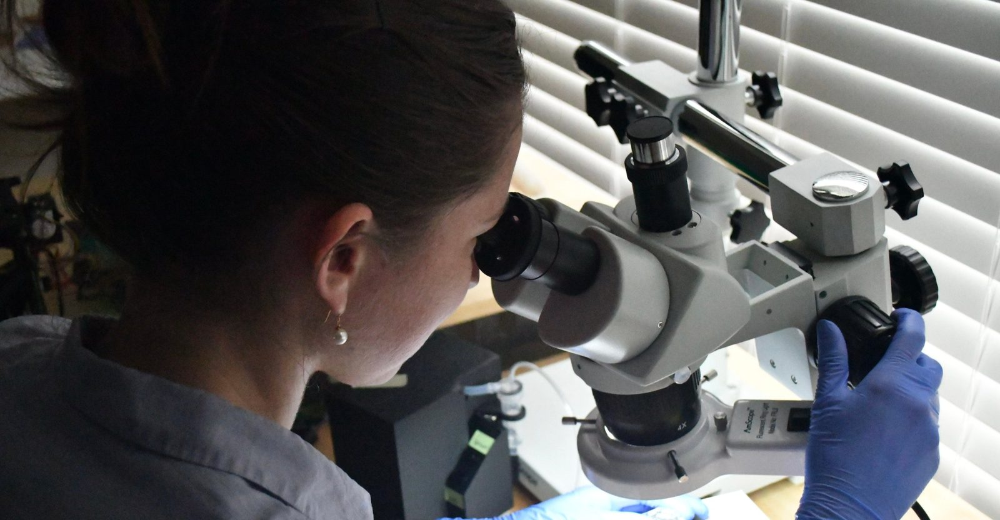

<section class="hero">
  

    
Founding Engineer, <a href="https://deleon.bio">Deleon Technologies</a>

    <h1>Nellie Kolon</h1>
    
Biochemist and biomedical engineer. I lead R&amp;D on the lab side of an AI research company that measures human metabolism at home, every day.

    

      <a class="cta" href="/resume.pdf">Resume →</a>
      <a href="https://www.linkedin.com/in/nellie-kolon-8b4b3613a/">LinkedIn</a>
      <a href="mailto:nellie@kolon.org">nellie@kolon.org</a>
    

  

  <figure class="portrait">
    
  </figure>
</section>

  <svg viewBox="0 0 1000 100" preserveAspectRatio="none" focusable="false"><path d="M0,98.0 L4,97.7 L8,97.5 L12,97.3 L16,97.3 L20,97.4 L24,97.7 L28,98.0 L32,98.3 L36,98.5 L40,98.7 L44,98.7 L48,98.6 L52,98.3 L56,98.0 L60,97.6 L64,97.1 L68,96.4 L72,95.3 L76,93.7 L80,91.6 L84,89.6 L88,88.4 L92,88.7 L96,90.3 L100,92.6 L104,94.8 L108,96.4 L112,97.2 L116,97.4 L120,97.4 L124,97.3 L128,97.3 L132,97.4 L136,97.5 L140,97.3 L144,95.4 L148,89.7 L152,78.9 L156,66.4 L160,60.6 L164,66.1 L168,78.4 L172,89.1 L176,94.8 L180,96.7 L184,97.1 L188,97.0 L192,95.5 L196,90.7 L200,82.6 L204,76.7 L208,79.2 L212,87.6 L216,94.5 L220,97.5 L224,98.0 L228,97.8 L232,97.6 L236,97.4 L240,97.3 L244,97.4 L248,97.5 L252,97.8 L256,98.1 L260,98.4 L264,98.6 L268,98.7 L272,98.5 L276,97.7 L280,95.1 L284,88.4 L288,74.9 L292,54.9 L296,35.5 L300,27.3 L304,35.7 L308,55.3 L312,75.0 L316,86.9 L320,88.0 L324,79.7 L328,70.1 L332,70.1 L336,80.1 L340,90.5 L344,95.7 L348,97.1 L352,97.3 L356,97.3 L360,97.5 L364,97.7 L368,98.0 L372,98.3 L376,98.6 L380,98.7 L384,98.7 L388,98.5 L392,98.2 L396,97.5 L400,96.3 L404,94.2 L408,90.7 L412,86.5 L416,83.0 L420,81.7 L424,83.5 L428,87.5 L432,92.0 L436,95.4 L440,97.3 L444,98.1 L448,98.2 L452,98.0 L456,97.7 L460,97.5 L464,97.3 L468,97.3 L472,97.4 L476,97.4 L480,96.4 L484,91.5 L488,77.3 L492,50.8 L496,20.6 L500,6.6 L504,20.2 L508,50.2 L512,76.6 L516,90.7 L520,95.6 L524,95.7 L528,90.9 L532,77.9 L536,59.5 L540,50.2 L544,60.0 L548,78.9 L552,92.2 L556,97.2 L560,98.2 L564,98.1 L568,97.8 L572,97.5 L576,97.4 L580,97.3 L584,97.2 L588,97.0 L592,95.8 L596,92.5 L600,86.5 L604,79.0 L608,73.5 L612,73.4 L616,78.8 L620,86.3 L624,92.2 L628,95.5 L632,96.8 L636,97.2 L640,97.3 L644,97.5 L648,97.8 L652,98.1 L656,98.4 L660,98.6 L664,98.7 L668,98.6 L672,98.4 L676,98.0 L680,96.9 L684,93.2 L688,83.6 L692,66.1 L696,46.4 L700,37.5 L704,46.8 L708,66.9 L712,84.6 L716,94.2 L720,97.3 L724,95.5 L728,85.7 L732,69.8 L736,64.6 L740,77.0 L744,90.7 L748,96.1 L752,97.2 L756,97.5 L760,97.7 L764,98.0 L768,98.3 L772,98.6 L776,98.7 L780,98.7 L784,98.5 L788,98.2 L792,97.8 L796,97.2 L800,95.9 L804,93.6 L808,89.9 L812,85.3 L816,81.4 L820,80.0 L824,82.0 L828,86.4 L832,91.3 L836,95.0 L840,97.0 L844,97.8 L848,97.9 L852,97.7 L856,97.5 L860,97.3 L864,97.3 L868,97.4 L872,97.6 L876,97.8 L880,97.5 L884,95.3 L888,88.5 L892,75.8 L896,61.2 L900,54.4 L904,60.7 L908,74.9 L912,87.4 L916,94.1 L920,96.6 L924,97.2 L928,97.3 L932,97.0 L936,95.6 L940,93.0 L944,89.6 L948,87.1 L952,87.0 L956,89.3 L960,92.6 L964,95.2 L968,96.6 L972,97.1 L976,97.2 L980,97.4 L984,97.6 L988,97.9 L992,98.2 L996,98.5 L1000,98.6"/></svg>

<section id="deleon" class="band">
  

    

      
Now

      
Sep 2025 – present Atlanta, GA

    

    

      <h2>Deleon Technologies</h2>
      
<a href="https://deleon.bio">Deleon</a> is an AI research company building models and autonomous instruments to learn human biology. Its at-home instrument, Otea, measures a person’s metabolism several times a day, so a model can predict how the body will respond to an intervention and check that prediction the same day.

      <h3>What I do</h3>
      <ul class="points">
        <li>Lead R&amp;D for the lab, from assay design to the chemical data our models train on.</li>
        <li>Lead development of a microfluidic capillary electrophoresis assay with laser-induced fluorescence detection (CE-LIF) that generates quantitative metabolite measurements.</li>
        <li>Act as the biology domain expert for our ML engineers, translating metabolic pathways and physiology into model design.</li>
        <li>Hired, trained, and manage our research interns.</li>
        <li>Use AI-assisted, human-in-the-loop optimization to choose what the lab tests next.</li>
      </ul>
    

  

  

    <figure class="wide">
      
      <figcaption>The Deleon team in Atlanta</figcaption>
    </figure>
    <figure>
      
      <figcaption>At the microscope</figcaption>
    </figure>
  

</section>

<section id="experience">
  

    

Before

    

      <h2>Experience</h2>
      

        <article class="job">
          
2024 – 2025

          

            <h3>Graduate Student Researcher</h3>
            
Georgia Tech · Ackun-Farmmer Lab

            
Designed peptide-targeted polymer nanoparticles to reprogram T cell responses, cut a synthesis process from 10 hours to 30 minutes, and mentored an undergraduate researcher.

          

        </article>
        <article class="job">
          
2021 – 2024

          

            <h3>Senior Research Associate, Genetic Medicine</h3>
            
Eli Lilly and Company · Cambridge, MA

            
Built a high-throughput platform that formulated and characterized 100+ lipid nanoparticles a week for nucleic acid delivery to the brain, used Design of Experiments to guide formulation, and developed scale-up methods with microfluidic mixing and tangential flow filtration.

          

        </article>
        <article class="job">
          
2019

          

            <h3>Analytical Chemistry Co-op</h3>
            
Takeda Pharmaceuticals · Cambridge, MA

            
Ran purity, stability, and solubility assays on oncology drug candidates and presented an in vivo ELISA study to 50+ scientists.

          

        </article>
      

    

  

</section>

<section id="education" class="tight">
  

    

Education

    

      
<strong>M.S. Biomedical Engineering</strong>Georgia Institute of Technology · 2025

      
<strong>B.S. Biochemistry, Magna Cum Laude</strong>Northeastern University · 2021

    

  

</section>

<section id="publications">
  

    

Published

    

      <h2>Publications</h2>
      <ol class="pubs">
        <li>
          <a href="https://doi.org/10.1039/d6bm00653a">Biomaterial-mediated immunomodulation of regulatory T cells in cancer</a>
          Hengen, A.C.; <strong>Kolon, H.</strong>; Ackun-Farmmer, M.A. · <em>Biomaterials Science</em>, 2026
        </li>
        <li>
          <a href="https://doi.org/10.1021/acs.jchemed.1c00999">How Participation in a Research Experiences for Undergraduates Program (REU) Transforms Chemistry and Biochemistry Majors’ Understanding of Research and Scientific Inquiry</a>
          <strong>Kolon, H.</strong>; Mabrouk, P.A. · <em>Journal of Chemical Education</em>, 2022 · Editor’s Choice
        </li>
      </ol>
    

  

</section>
