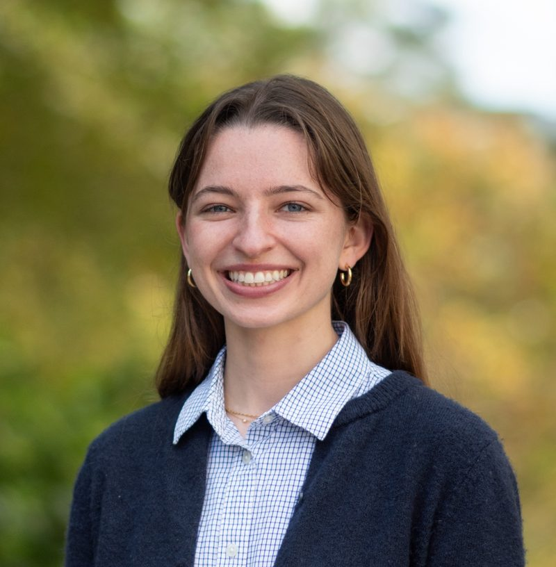
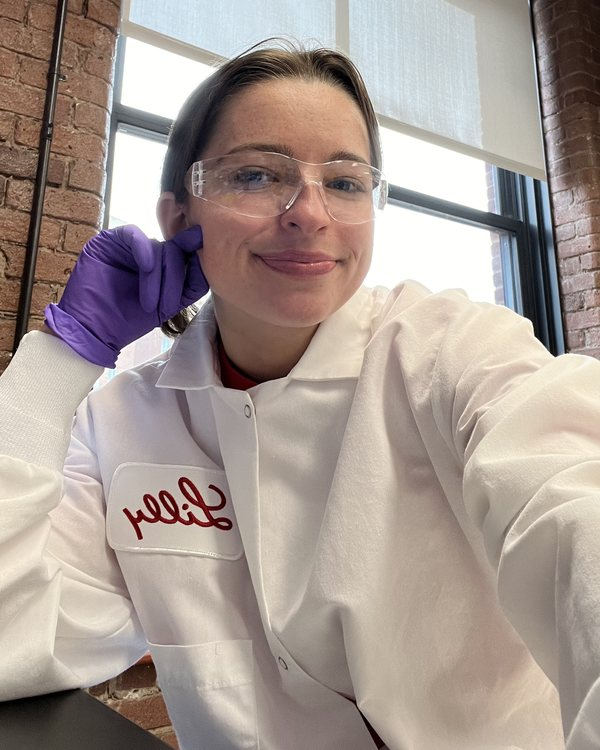

<section class="intro">
  

    <h1>Nellie Kolon</h1>
    
Founding Engineer at <a href="https://deleon.bio">Deleon Technologies</a>

    
I’m a biochemist and biomedical engineer. At Deleon, I lead R&amp;D on the lab side of an AI research company that measures human metabolism at home, every day. Before that, I spent three years developing lipid nanoparticle medicines at Eli Lilly.

    

      <a class="button primary" href="/resume.pdf">Resume</a>
      <a class="button" href="https://www.linkedin.com/in/nellie-kolon-8b4b3613a/">LinkedIn</a>
      <a class="button" href="mailto:nellie@kolon.org">Email</a>
    

  

  
</section>

<section id="deleon">
  

    
Now

    <h2>Deleon Technologies</h2>
    
Founding Engineer · Atlanta, GA · September 2025 – present

  

  

    
<a href="https://deleon.bio">Deleon</a> is an AI research company building models and autonomous instruments to learn human biology. Its at-home instrument, Otea, measures a person’s metabolism several times a day, so a model can predict how the body will respond to an intervention and check that prediction the same day.

    
My role:

  

  <ul class="points">
    <li>Lead R&amp;D for the lab, from assay design to the chemical data our models train on.</li>
    <li>Lead development of a microfluidic capillary electrophoresis assay with laser-induced fluorescence detection (CE-LIF) that generates quantitative metabolite measurements.</li>
    <li>Act as the biology domain expert for our ML engineers, translating metabolic pathways and physiology into model design.</li>
    <li>Hired, trained, and manage our research interns.</li>
    <li>Use AI-assisted, human-in-the-loop optimization to choose what the lab tests next.</li>
  </ul>
  

    <figure>
      
      <figcaption>The Deleon team in Atlanta.</figcaption>
    </figure>
    <figure>
      
      <figcaption>At the microscope in the Deleon lab.</figcaption>
    </figure>
  

</section>

<section id="experience">
  

    
Before Deleon

    <h2>Experience</h2>
  

  

    

      
2024 – 2025

      

        <h3>Graduate Student Researcher</h3>
        
Georgia Institute of Technology, Ackun-Farmmer Lab

        
Designed peptide-targeted polymer nanoparticles to reprogram T cell responses, cut a synthesis process from 10 hours to 30 minutes, and mentored an undergraduate researcher.

      

    

    

      
2021 – 2024

      

        

        <h3>Senior Research Associate, Genetic Medicine</h3>
        
Eli Lilly and Company, Cambridge, MA

        
Built a high-throughput platform that formulated and characterized 100+ lipid nanoparticles a week for nucleic acid delivery to the brain, used Design of Experiments to guide formulation, and developed scale-up methods with microfluidic mixing and tangential flow filtration.

        

        <figure class="job-photo">
          
          <figcaption>In the lab at Lilly, Cambridge</figcaption>
        </figure>
      

    

    

      
2019

      

        <h3>Analytical Chemistry Co-op</h3>
        
Takeda Pharmaceuticals, Cambridge, MA

        
Ran purity, stability, and solubility assays on oncology drug candidates and presented an in vivo ELISA study to 50+ scientists.

      

    

  

  
Education

  

    

      
2025

      

        <h3>M.S. Biomedical Engineering</h3>
        
Georgia Institute of Technology

      

    

    

      
2021

      

        <h3>B.S. Biochemistry, Magna Cum Laude</h3>
        
Northeastern University

      

    

  

</section>

<section id="publications">
  

    <h2>Publications</h2>
  

  <ul class="pubs">
    <li>
      <a class="title" href="https://doi.org/10.1039/d6bm00653a">Biomaterial-mediated immunomodulation of regulatory T cells in cancer</a>
      Hengen, A.C.; <strong>Kolon, H.</strong>; Ackun-Farmmer, M.A. <em>Biomaterials Science</em>, 2026
    </li>
    <li>
      <a class="title" href="https://doi.org/10.1021/acs.jchemed.1c00999">How Participation in a Research Experiences for Undergraduates Program (REU) Transforms Chemistry and Biochemistry Majors’ Understanding of Research and Scientific Inquiry</a>
      <strong>Kolon, H.</strong>; Mabrouk, P.A. <em>Journal of Chemical Education</em>, 2022 · Editor’s Choice
    </li>
  </ul>
</section>
