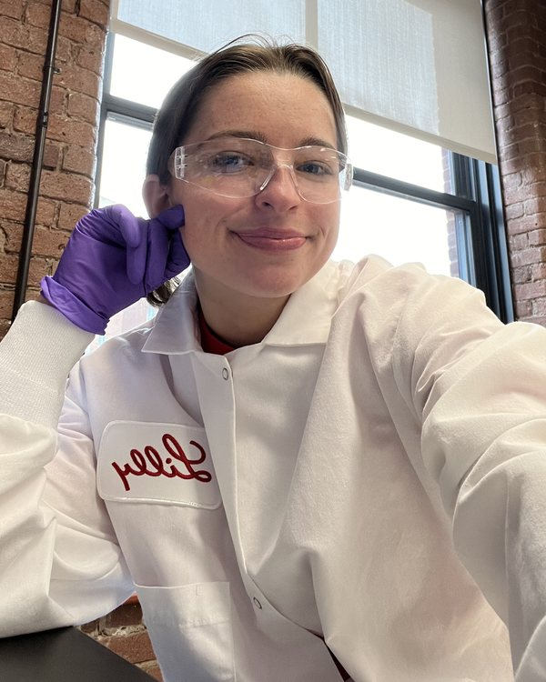

<section class="tutor-hero">
  <h1 class="tutor-title">SAT + AP Tutoring</h1>
  

    
    

      
Hi, I’m Nellie!

      
M.S. Biomedical Engineering Georgia Tech

    

    
I’m a biochemist and biomedical engineer, and I’ve been tutoring high school students since 2022. I love helping students build confidence in what they know.

  

</section>

<section id="request">
  

    
Get started

    <h2>Request tutoring</h2>
  

  <form class="tutor-form" id="tutor-form" action="https://formspree.io/f/xzeelpze" method="POST">
    

      <label for="name">Your name</label>
      <input id="name" name="name" type="text" autocomplete="name" required>
    

    

      

        <label for="email">Email</label>
        <input id="email" name="email" type="email" autocomplete="email" required>
      

      

        <label for="phone">Phone (optional)</label>
        <input id="phone" name="phone" type="tel" autocomplete="tel">
      

    

    

      <label for="relationship">I am a</label>
      <select id="relationship" name="relationship" required>
        <option value="">Choose one</option>
        <option>Parent or guardian</option>
        <option>Student</option>
      </select>
    

    

      <label for="grade">Student’s grade</label>
      <select id="grade" name="grade" required>
        <option value="">Choose one</option>
        <option>9th</option>
        <option>10th</option>
        <option>11th</option>
        <option>12th</option>
        <option>Other</option>
      </select>
    

    <fieldset class="field">
      <legend>Subjects</legend>
      <label class="check"><input type="checkbox" name="subjects" value="SAT prep" id="subj-sat"> SAT prep</label>
      <label class="check"><input type="checkbox" name="subjects" value="AP Biology" id="subj-bio"> AP Biology</label>
      <label class="check"><input type="checkbox" name="subjects" value="AP Chemistry" id="subj-chem"> AP Chemistry</label>
      <label class="check"><input type="checkbox" name="subjects" value="Other" id="subj-other"> Other</label>
      <input id="subjects-other" name="subjects_other" type="text" placeholder="What subject?" aria-label="Other subject" hidden>
    </fieldset>
    <fieldset class="field">
      <legend>Format</legend>
      <label class="check"><input type="radio" name="format" value="In person" id="fmt-in" required> In person</label>
      <label class="check"><input type="radio" name="format" value="Online" id="fmt-online"> Online</label>
      <label class="check"><input type="radio" name="format" value="Either" id="fmt-either"> Either</label>
    </fieldset>
    

      <label for="availability">When are you usually available?</label>
      <input id="availability" name="availability" type="text" placeholder="For example, weekday evenings or Sunday mornings">
    

    

      <label for="message">Anything else I should know? (optional)</label>
      <textarea id="message" name="message" rows="4" placeholder="Goals, test dates, or what’s been hard so far"></textarea>
    

    <input type="text" name="_gotcha" class="hp" tabindex="-1" autocomplete="off" aria-hidden="true">
    <button class="button primary" type="submit">Send request</button>
    

  </form>
</section>

